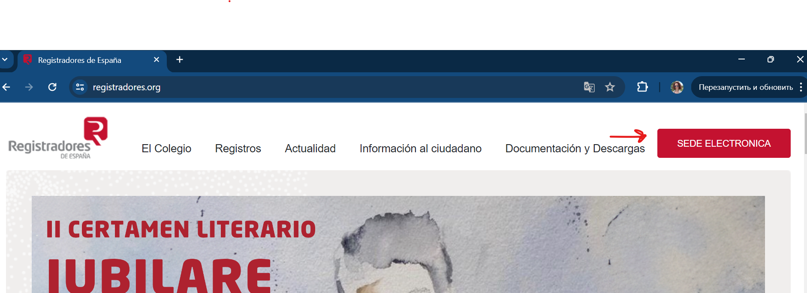
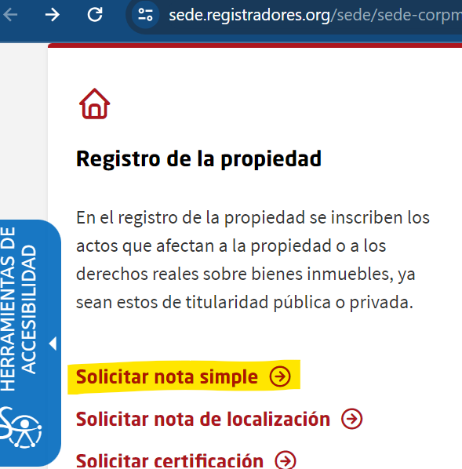
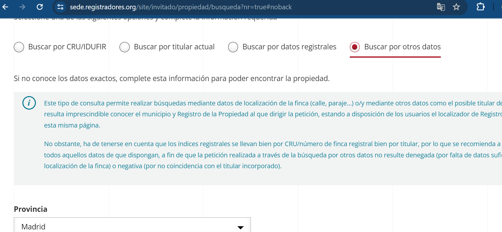
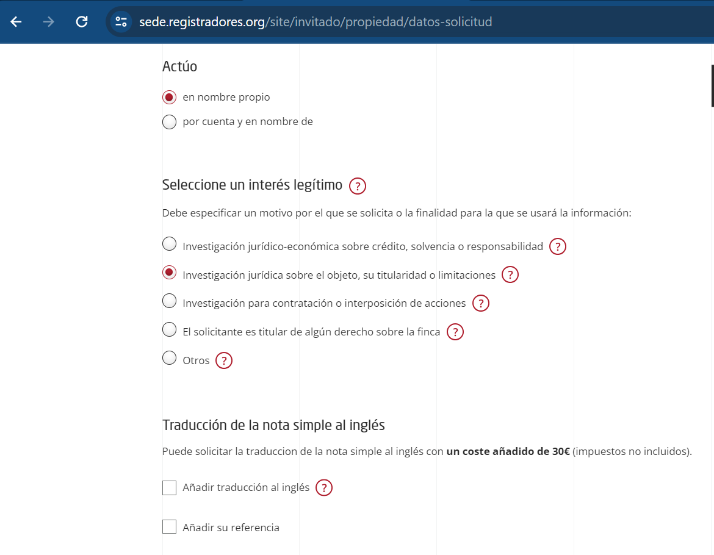
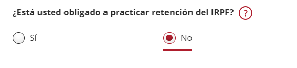

import { Steps } from "@astrojs/starlight/components";

:::note
Nota simple — это официальный документ, выдаваемый Реестром недвижимости в Испании. Он содержит основную информацию о недвижимости:

1. Сведения об объекте: местоположение, площадь, описание и кадастровый номер.
2. Право собственности: данные о владельцах и их долях в праве собственности.
3. Обременения и ограничения: сведения о залогах, ипотечных кредитах, сервитутах, арестах и других ограничениях, наложенных на имущество.

Nota simple используется для проверки правового статуса недвижимости перед её покупкой, продажей или арендой, чтобы убедиться в отсутствии скрытых проблем или задолженностей.

**Стоимость** (Sede Electrónica Registradores): **9,02 € + IVA**; перевод на английский — **+30 €**.
:::

:::caution
Скриншоты ниже могут быть устаревшими. Уточняйте стоимость на сайте перед оплатой.
:::

## Как получить выписку

<Steps>
1. Открываем сайт [registradores.org](https://www.registradores.org/).

1. Нажимаем «Sede electrónica».
   

1. Далее «Solicitar nota simple».
   

1. Выбираем способ поиска объекта недвижимости. Для поиска по адресу выбираем «Buscar por otros datos» и вводим полный адрес в открывшейся форме.
   

1. На следующей странице выбираем «En nombre propio» (действуем от своего имени) и указываем, для чего нужна nota simple (например: исследование юридической информации об объекте и его собственнике). Если нужен сразу перевод на английский – можно поставить галочку (**+30 €**).
   

1. На следующей странице вводим персональные данные. Проверяем адрес электронной почты: на него придёт готовый документ. В конце выбираем пункт про IRPF.
   

1. Далее переходим к странице оплаты (**9,02 € + IVA**; с переводом — ещё **+30 €**). После оплаты готовый документ вышлют на электронную почту (примерно через 4 часа).

</Steps>
