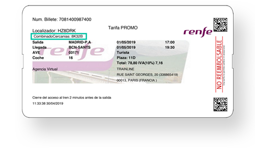

В Мадриде и по всей Испании работают несколько железнодорожных операторов. Они предлагают поездки на высокоскоростных и обычных поездах.

## Renfe

[Renfe](https://www.renfe.com/es/es) — национальный оператор железных дорог Испании.

- Предлагает широкую сеть маршрутов по всей стране
- Высокоскоростные поезда AVE (Alta Velocidad Española)
- Пригородные поезда Cercanías в крупных городах
- Региональные и междугородние поезда

### Renfe Combinado Cercanías

Renfe предлагает специальную услугу под названием ["Combinado Cercanías"](https://www.renfe.com/es/es/viajar/prepara-tu-viaje/billetes-ave-y-largadistancia/todos-los-billetes):

- Бесплатный проезд на пригородных поездах Cercanías, Rodalies и FEVE, а также на трамваях Аликанте при покупке билета на поезда AVE или другие дальние маршруты Renfe (не в Avlo)
- Действует в течение 4 часов до отправления и 4 часов после прибытия дальнего поезда
- Доступно в крупных городах и регионах, включая Мадрид, Барселону, Валенсию, Севилью и другие
- Чтобы воспользоваться услугой, нужно отсканировать QR-код с билета или ввести пятизначный код в автомате на станции Cercanías 
- В Мадриде на турникетах со сканером кодов можно приложить **BIDI** билета AVE/Larga Distancia без обмена в автомате.

### Абонементы Cercanías (Abonos Bonificados, 2026)

До конца **2026** года действуют абонементы со скидкой Renfe (нужна персональная карта Renfe&Tú):

- **Abono mensual**: **20 €**/месяц, безлимит во всех сетях Cercanías
- **Abono mensual Joven**: **10 €**/месяц
- **Abono Infantil**: бесплатно на весь 2026 год (нужен код Минтранса; даты рождения — см. FAQ Renfe)

Оформление: приложение [Renfe Cercanías](https://play.google.com/store/apps/details?id=com.renfe.renfecercanias), сайт Renfe, автоматы или кассы на станциях.

Источник и актуальные правила: [Abonos Bonificados](https://www.renfe.com/es/es/promociones/abonos-renfe/abonos-bonificados).

### Abono Único (2026)

С **19 января 2026 года** действует персональный [Abono Único](https://www.renfe.com/es/es/normativa): **60 € на 30 дней**. Льготный вариант **30 €** предназначен для граждан Испании и иностранцев с законным проживанием, родившихся с 1 января 2000 года по 31 декабря 2026 года; требуется предварительная регистрация в системе Ministerio de Transportes и код скидки.

Он покрывает Cercanías/Rodalies, обычные Media Distancia и автобусные маршруты государственной концессии. Это не билет на все поезда и автобусы: **AVE и Avlo не включены**, а для Avant действуют отдельные перечисленные в правилах исключения. Для поездов с закреплённым местом необходимо заранее оформить бронирование на конкретный рейс; действуют ограничения и правила отмены.

Для поездок только по Мадриду сначала проверьте свой [Abono Transporte](/transport/transport-cards/): он уже включает Cercanías в оплаченных зонах. Отдельный Renfe-абонемент нужен не всегда.

## Ouigo

[Ouigo](https://www.ouigo.com/es/) — оператор высокоскоростных поездов, принадлежащий французской национальной железнодорожной компании SNCF.

- Предлагает бюджетные высокоскоростные маршруты
- Соединяет Мадрид с такими городами, как Барселона, Валенсия и Аликанте
- Известен своими низкими ценами и простой моделью обслуживания

## Iryo

[Iryo](https://iryo.eu/en/home) — частный оператор высокоскоростных поездов в Испании.

- Предлагает маршруты между крупными городами, включая Мадрид, Барселону, Валенсию и Севилью
- Использует современные высокоскоростные поезда
- Акцент на качество обслуживания и экологичность
- Также предоставляет услугу [Combinado Cercanías](#renfe-combinado-cercanías), аналогичную Renfe
